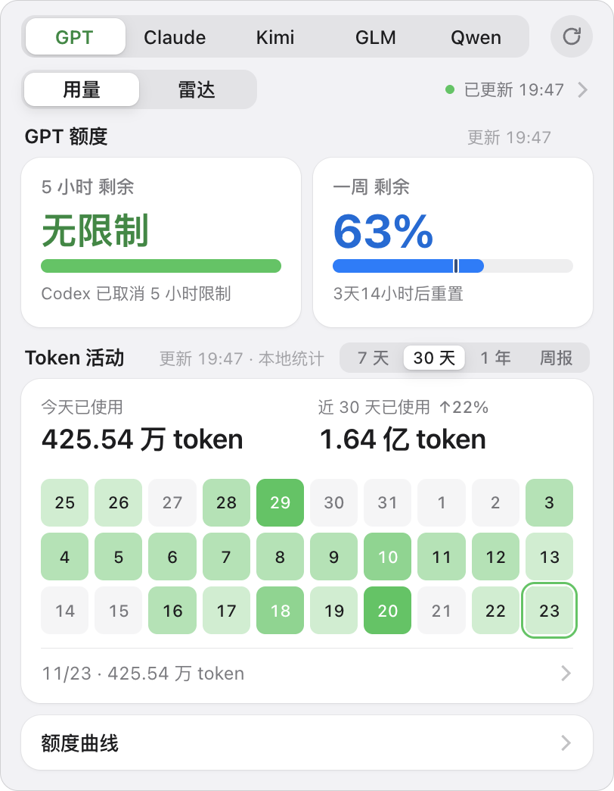
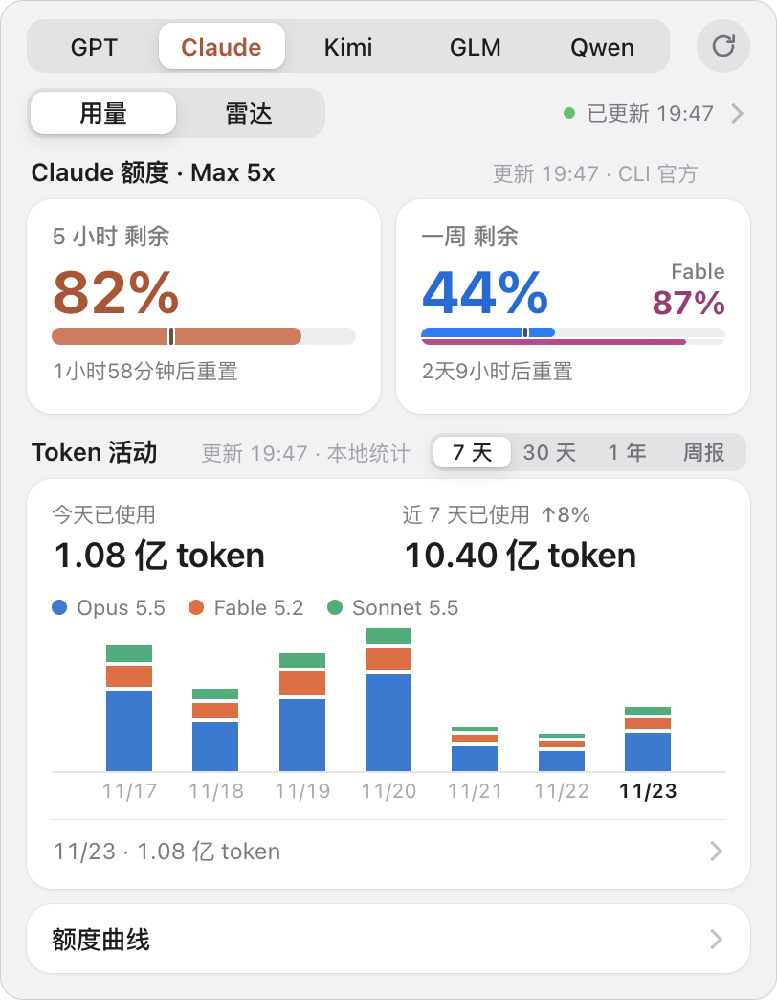
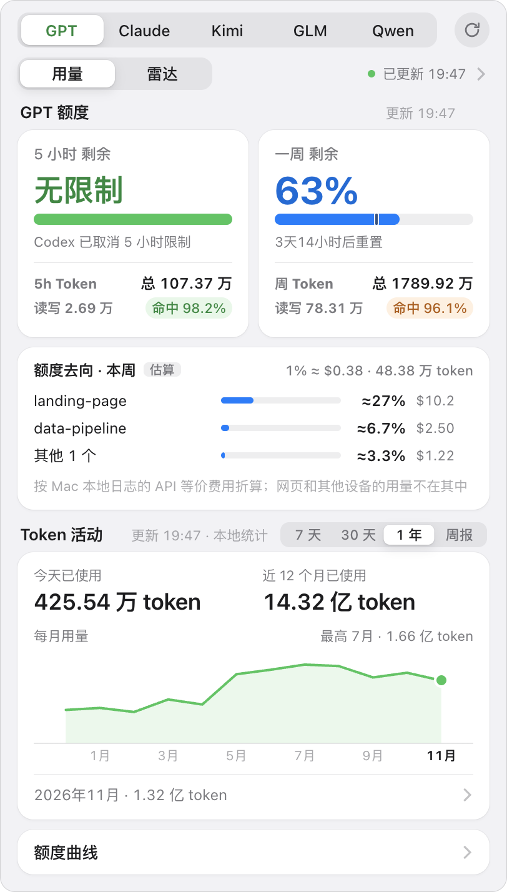
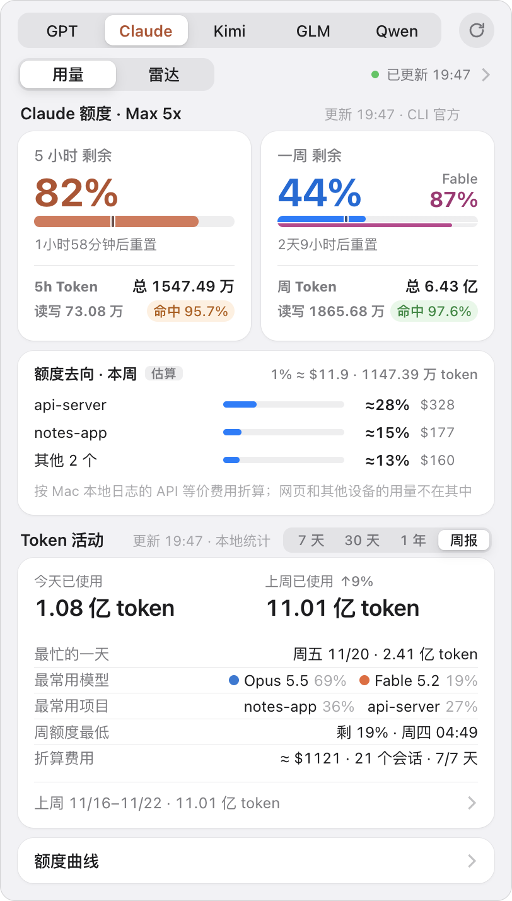

# Codex Menu Meter

> [!IMPORTANT]
> **本 APP 由 Claude Fable 5.2 及 GPT6 Astra 开发完成。**


Codex Menu Meter 是一款 macOS 菜单栏小工具：查看 GPT（Codex）与 Claude Code 的剩余额度、重置时间、本地 Token 活动和模型雷达，支持 Touch Bar、手机查看和加密云同步。还可按需启用 Kimi / GLM Coding Plan 额度查询；Qwen 在当前版本中仅提供说明入口。

| 平台 | 当前版本 | 开发者 | 许可 |
|---|---|---|---|
| macOS（Intel / Apple Silicon） | 2.0.0 | Jerry Wong | [MIT](LICENSE) |

## 主要功能

- 菜单栏实时显示当前平台的 5 小时 / 周剩余额度；切到 Claude 时标题带 `CC` 前缀。
- 点开面板：额度卡（含同周期 Token 总量、读写量、缓存命中率）、近 24 小时 / 7 天额度曲线与触顶预估、Token 活动与折算 API 成本、雷达页的模型 IQ。
- Token 活动：7 天（按模型分色的直方图）/ 30 天（日历格子）/ 1 年（每月用量连成的折线）/ 周报 一键切换，并显示和前一段同样长的时间相比的变化。周报列出上周一到周日最忙的一天、最常用的模型和项目、周额度最低剩多少和折算费用。单日明细里有按小时的用量分布，Claude 还标出当天每个 5 小时窗口用到了多少。用量按天存在本机，首次启动会在后台读一遍旧日志，补回以前的记录；Codex 压缩过的旧会话（`.jsonl.zst`）也计入统计。
- 额度去向：展开额度明细后，可以看本周额度大致花在了哪几个项目上（按 API 等价费用估算）。
- 别的应用全屏时也能浮在最上层打开，不会把屏幕切回桌面。
- 全局快捷键 ⌥⌘U 呼出 / 收起面板（设置中可关）；点击面板外部自动收起。
- 额度提醒：剩余到阈值（默认 20% / 5%）、按当前速度会在重置前用尽、窗口重置时发系统通知；点通知直接打开面板。可同时推送到 Bark 或 ntfy。另有重置卡到期提醒（过期前 3 天和 1 天），以及周额度重置前 12 小时、还剩 20% 以上时的提醒。
- 新版本提示：定时查询 GitHub Releases，有新版本时通知，只提示、不自动安装。设置里可以复制脱敏后的诊断信息，方便反馈问题。
- 「跟随前台应用」：Codex（ChatGPT 桌面端）或 Claude 桌面端进入前台时，菜单栏和 Touch Bar 静默切到对应平台。
- 手机查看：同一局域网 / Tailscale 下的实时只读页面，或端到端加密的云同步（Mac 离线时也能看最后一次数据）。
- 界面语言：中文 / English / 日本語；外观：浅色 / 深色 / 跟随系统。





以上截图使用合成演示数据（`node scripts/make-demo-state.js` 生成），项目名、用量和费用都是编的。

## 下载与安装

从 [GitHub Releases](https://github.com/WZR0821/Codex-Menu-Meter/releases/latest) 下载与你的 Mac 芯片对应的 DMG，打开后将应用拖入 Applications。已有用户覆盖安装会保留本机设置。

安装包是 ad-hoc 签名，没有经过 Apple 公证，首次打开需在「系统设置 → 隐私与安全性」里放行。

### 开始使用

1. 完成本机 Codex / Claude Code CLI 登录。
2. 右键菜单栏图标打开设置，开启需要的平台。
3. 左键查看面板；按需配置手机查看、通知和云同步。

完整功能介绍见 [首发说明](docs/RELEASE-1.0.0.md)。

## 数据与隐私

所有凭证只在本机主进程中使用，不会写入项目、不会传给界面层，也不会上传到云同步服务。

### 数据来源

- **Codex 用量**：读取本机 `~/.codex/auth.json` 的登录凭证，只读请求 `chatgpt.com/backend-api/wham/usage` 与 `wham/rate-limit-reset-credits`。窗口按 `limit_window_seconds` 归类；只返回周窗口时，5 小时卡显示「无限制 ∞」。
- **Codex Token 活动**：离线统计 `~/.codex/sessions` 与 `~/.codex/archived_sessions` 里的 `token_count` 事件（覆盖 CLI / VS Code / 桌面版），排除子代理日志中继承的父任务历史。Codex 压缩成 `.jsonl.zst` 的闲置会话也会读取（分块边读边解压，解析结果缓存在本机）。
- **Claude 用量**：读取 Claude Code CLI 的登录凭证（钥匙串 `Claude Code-credentials` 或 `~/.claude/.credentials.json`），请求 `api.anthropic.com/api/oauth/usage`。令牌临近过期或返回 401 时刷新一次，并把新令牌写回原来的凭证来源。官方请求失败时保留上一次结果并显示错误，不用本地记录推算额度。
- **Claude Token 活动**：离线统计 `~/.claude/projects` 里的会话记录。
- **按天存档**：近 30 天每次刷新都从日志重新统计；更早的日子从本机 `token-daily.json` 读取（最多保留 800 天），等价费用按当前价格表重新计算。
- **雷达**：Codex 智力页读 `codexradar.com/data/codex-four-task-results.json`（四题众测正式分榜，满分 150），额度页读 `codexradar.com/current.json`；Claude 读 `claudecoderadar.com/data/claude-code-radar.json`。界面保留来源标注。
- **Kimi Code**：`api.kimi.com/coding/v1/usages`（Coding Plan 专用 Key）。
- **GLM Coding Plan**：`open.bigmodel.cn/api/monitor/usage/quota/limit`（国际站 `api.z.ai` 同路径，自动探测）。
- **Qwen Coding Plan**：官方暂无额度查询接口，开启后只显示说明。
- **价格表**：每天从 LiteLLM 的公开价格表（`raw.githubusercontent.com/BerriAI/litellm/main/model_prices_and_context_window.json`）取一次，缓存在本机 `model-prices.json`，取不到时用内置价格。可在设置里关闭。
- **新版本检查**：每 12 小时请求一次 `api.github.com/repos/WZR0821/Codex-Menu-Meter/releases/latest`，只读取最新版本号和下载页地址。可在设置里关闭。

Kimi / GLM 的 API Key 存在 macOS 钥匙串（服务名 `Codex Menu Meter API Key`；旧版本存在设置文件里的 Key，升级后首次启动时会自动搬进钥匙串），也可用环境变量 `KIMI_API_KEY`、`GLM_API_KEY` / `ZHIPU_API_KEY` 提供。额度曲线的采样存在本机 `usage-history.json`，保留 30 天。

### 加密云同步

Mac 生成 256 位主密钥，用 HKDF-SHA256 派生出 AES-GCM 加密密钥和服务鉴权令牌。主密钥只存于 macOS 钥匙串和已配对手机的 IndexedDB；配对链接把密钥放在 URL fragment 里，浏览器读取后立即清除。同步服务（Cloudflare Worker + Durable Object）只收到鉴权令牌和密文，读不到任何用量数据。

部署自己的同步服务：

```bash
npx wrangler login
npm run sync:deploy
```

然后在设置的「加密云同步」里填入你的 Worker 地址（也可以用环境变量 `CMM_SYNC_SERVER_URL`）。公开版本不内置同步服务器地址，新用户需要自行部署和配置；升级会保留已保存的本机地址与配对。

## 开发与构建

运行环境：

- macOS（Intel 与 Apple Silicon 均可）
- Node.js 与 npm；Electron 43 由 `npm ci` 安装
- 编译 Touch Bar 助手需要 Xcode 或命令行工具里的 Swift 编译器

从源码运行与打包：

```bash
npm ci
npm run build:native   # 编译 Touch Bar 助手和双架构 AppKit 悬浮窗模块
npm start
```

```bash
npm run build:mac                  # 本机架构，输出 .app 目录（dist/mac*）
npm run build:intel-dmg            # Intel DMG
npm run build:apple-silicon-dmg    # Apple Silicon DMG
```

测试：

```bash
npm run lint
npm test
npm run qa:render     # 面板视觉 QA 截图
npm run qa:settings   # 设置窗口视觉 QA
npm run qa:panel      # 真正的 Electron / AppKit 窗口属性、重复开关与取消恢复检查
bash scripts/smoke-test.sh "dist/mac/Codex Menu Meter.app"   # 冒烟测试：用单独的数据目录启动打包好的应用
node scripts/make-demo-state.js > /tmp/cmm-demo.json         # 生成截图用的合成演示数据
```

推送到 GitHub 后，GitHub Actions 会在 Ubuntu 上跑语法检查和单元测试，再在 macOS 上打包 Apple Silicon 版应用并跑冒烟测试（见 `.github/workflows/ci.yml`）。

本地验证云同步 Worker 与完整配对链路：

```bash
npm run sync:dev -- --port 8787 --local
npm run qa:cloud
```

维护细节见 [DEVELOPMENT_MAINTENANCE.md](DEVELOPMENT_MAINTENANCE.md)。

## 项目结构

| 目录 | 用途 |
|---|---|
| `src/` | Electron 主进程、面板、设置页 |
| `src/mobile/` | 手机端页面（本地服务与云同步共用） |
| `native/` | Touch Bar 助手（Swift）与悬浮窗模块（Objective-C++ / Node-API） |
| `cloud/` | 云同步 Worker 与 Durable Object |
| `scripts/` | 打包、冒烟测试与视觉 QA 脚本 |
| `.github/workflows/` | GitHub Actions：语法检查、单元测试、打包与冒烟测试 |
| `test/` | 单元测试 |
| `docs/` | 发布记录、开发时间线、图标来源和截图 |

版本号在 `package.json` 里维护。

## 版本记录

- **2.0.0**：Codex 压缩会话计入统计；用量按天存档，新增 1 年折线、周报和环比，单日明细加按小时分布和 5 小时窗口；新增本周额度去向、重置卡到期提醒、周额度重置前提醒、新版本提示、LiteLLM 价格表自动更新和复制诊断信息；Kimi / GLM 的 API Key 改存钥匙串；缓存命中率改为 97% / 93% 分色；明细按钮悬停才显示，展开明细后面板宽度不变，GPT 和 Claude 一样高。[发布记录](docs/RELEASE-2.0.0.md)
- **1.1.1**：进度条加粗到和 Claude「一周」卡的双道条一样；5 小时卡和一周卡的明细由一个按钮一起展开；7 天 / 30 天切换加动效，直方图柱子去圆角并加高。[发布记录](docs/RELEASE-1.1.1.md)
- **1.1.0**：Token 活动新增 7 天 / 30 天切换，7 天为按模型分色的直方图；Claude 的 Fable 周限额并进「一周」卡。[发布记录](docs/RELEASE-1.1.0.md)
- **1.0.1**：修复全屏应用遮挡用量面板的问题。[发布记录](docs/RELEASE-1.0.1.md)
- **1.0.0**：首次公开发布。[首发说明](docs/RELEASE-1.0.0.md)
- **0.8.3 – 1.0.0 的开发历史**：已根据确认的本机快照补录 **2026 年 7 月 20 日至 11 月 17 日**的开发历史，共 **26 条提交、22 个版本**。日期采用日本时间，每条提交注明历史补录来源。详见 [开发时间线](docs/DEVELOPMENT-HISTORY.md) 与 [历史提交](https://github.com/WZR0821/Codex-Menu-Meter/commits/history/v1.0.0-20261117-225656/)。

安装包见 [Releases](https://github.com/WZR0821/Codex-Menu-Meter/releases)。

## 已知限制

- 安装包是 ad-hoc 签名，没有经过 Apple 公证。
- Qwen Coding Plan 官方暂无额度查询接口，只显示说明；Kimi / GLM 不提供本地 Token 活动和模型 IQ。
- 公开版本不内置同步服务器地址，云同步需要自行部署。
- 1 年视图和周报只能统计本机还留着的日志，在别的电脑上用的、或已经删掉的会话补不回来。额度去向按本机日志的 API 等价费用估算，不含网页版和其他设备上的用量。周报里的周额度最低点和单日的 5 小时窗口来自应用开着时的额度采样，应用没开的时段没有记录。
- 「跟随前台应用」不识别 Terminal / iTerm 内的具体标签页。
- Apple Silicon 实机与多显示器组合还没有实机验证；真实手机 Safari、Touch Bar 硬件和开机启动没有做完整的实机回归。
- 外部用量接口与雷达服务的可用性取决于对应服务。

## 许可与致谢

Codex Menu Meter 自身的代码以 [MIT 许可证](LICENSE) 开源。本项目为独立第三方工具，与 OpenAI、Anthropic 无隶属关系。图标融合 Codex 终端与 Claude 星芒元素，由内置图像生成工具制作，见 [图标来源](docs/ICON.md)。
