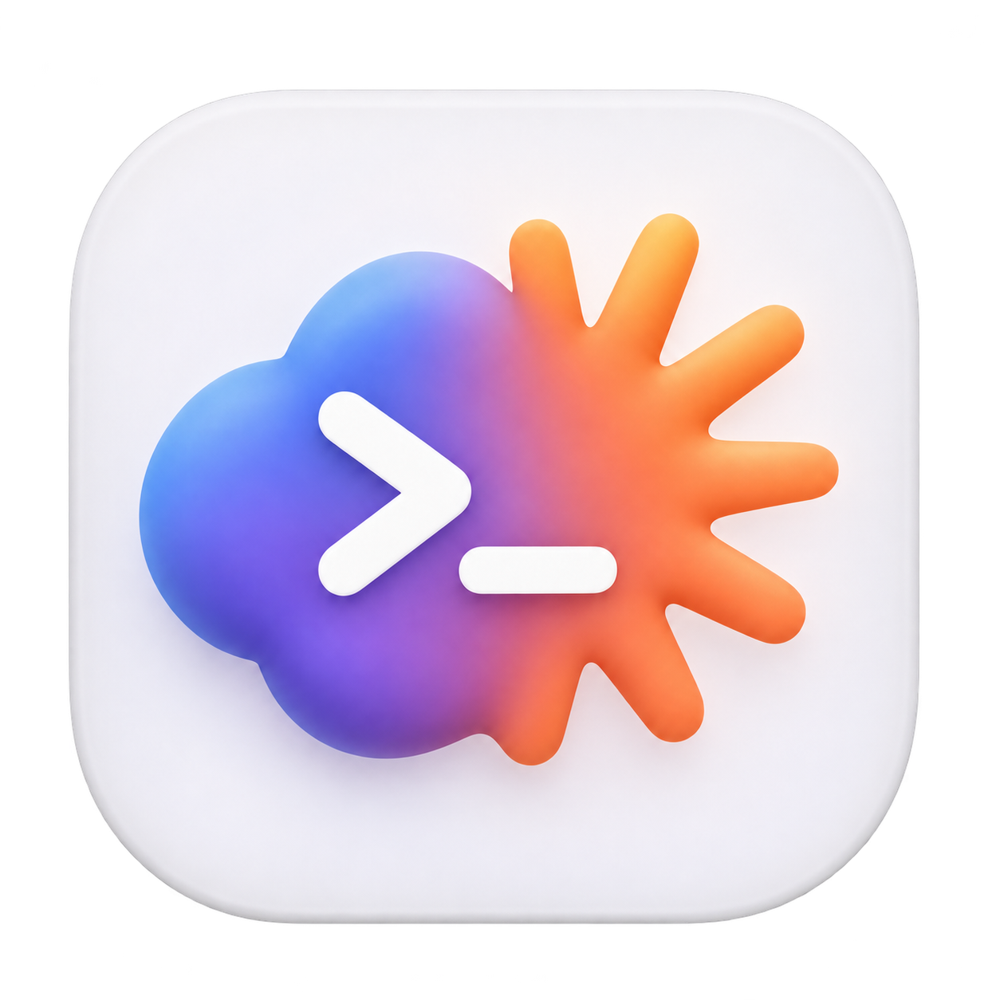

# Codex Menu Meter

> **本 APP 主要由 Claude Fable5.2 和 GPT6-Astra 生成。**

开发者：**Jerry Wong**。当前发布版本：**1.0.0**。



macOS 菜单栏小工具：在菜单栏、弹出面板和 Touch Bar 上显示 GPT（Codex）、Claude Code 以及 Kimi / GLM / Qwen Coding Plan 的用量额度、本地 Token 活动和对应雷达站的模型 IQ。

- 菜单栏实时显示当前平台的 5 小时 / 周剩余额度；切到 Claude 时标题带 `CC` 前缀。
- 点开面板：额度卡（含同周期 Token 总量、读写量、缓存命中率）、近 24 小时额度曲线与触顶预估、30 天 Token 活动热力图与折算 API 成本、雷达页的模型 IQ。
- 别的应用全屏时也能浮在最上层打开，不会把屏幕切回桌面。
- 全局快捷键 ⌥⌘U 呼出 / 收起面板（设置中可关）；点击面板外部自动收起。
- 额度提醒：剩余到阈值（默认 20% / 5%）、按当前速度会在重置前用尽、窗口重置时发系统通知；点通知直接打开面板。可同时推送到 Bark 或 ntfy。
- 「跟随前台应用」：Codex（ChatGPT 桌面端）或 Claude 桌面端进入前台时，菜单栏和 Touch Bar 静默切到对应平台。
- 手机查看：同一局域网 / Tailscale 下的实时只读页面，或端到端加密的云同步（Mac 离线时也能看最后一次数据）。
- 界面语言：中文 / English / 日本語；外观：浅色 / 深色 / 跟随系统。

右键菜单栏图标打开设置。

从 [GitHub Releases](https://github.com/WZR0821/Codex-Menu-Meter/releases/tag/v1.0.0) 下载与你的 Mac 芯片对应的 DMG，打开后将应用拖入 Applications。已有用户覆盖安装会保留本机设置。发布说明与验证范围见 [1.0.0 发布记录](docs/RELEASE-1.0.0.md)。


以上截图使用合成测试数据。

## 运行环境

- macOS（Intel 与 Apple Silicon 均可）
- Node.js 与 npm；Electron 43 由 `npm ci` 安装
- 编译 Touch Bar 助手需要 Xcode 或命令行工具里的 Swift 编译器

## 从源码运行与打包

```bash
npm ci
npm run build:native   # 编译 Touch Bar 助手（native/touchbar-helper）
npm start
```

```bash
npm run build:mac                  # 本机架构，输出 .app 目录（dist/mac*）
npm run build:intel-dmg            # Intel DMG
npm run build:apple-silicon-dmg    # Apple Silicon DMG
```

打包出的应用是 ad-hoc 签名，没有经过 Apple 公证，首次打开需在「系统设置 → 隐私与安全性」里放行。

## 测试

```bash
npm run lint
npm test
npm run qa:render     # 面板视觉 QA 截图
npm run qa:settings   # 设置窗口视觉 QA
```

## 数据来源

所有凭证只在本机主进程中使用，不会写入项目、不会传给界面层，也不会上传到云同步服务。

- **Codex 用量**：读取本机 `~/.codex/auth.json` 的登录凭证，只读请求 `chatgpt.com/backend-api/wham/usage` 与 `wham/rate-limit-reset-credits`。窗口按 `limit_window_seconds` 归类；只返回周窗口时，5 小时卡显示「无限制 ∞」。
- **Codex Token 活动**：离线统计 `~/.codex/sessions` 与 `~/.codex/archived_sessions` 里的 `token_count` 事件（覆盖 CLI / VS Code / 桌面版），排除子代理日志中继承的父任务历史。
- **Claude 用量**：读取 Claude Code CLI 的登录凭证（钥匙串 `Claude Code-credentials` 或 `~/.claude/.credentials.json`），请求 `api.anthropic.com/api/oauth/usage`。令牌临近过期或返回 401 时刷新一次，并把新令牌写回原来的凭证来源。官方请求失败时保留上一次结果并显示错误，不用本地记录推算额度。
- **Claude Token 活动**：离线统计 `~/.claude/projects` 近 30 天的会话记录。
- **雷达**：`codexradar.com/current.json` 与 `claudecoderadar.com/data/claude-code-radar.json`，界面保留来源标注。
- **Kimi Code**：`api.kimi.com/coding/v1/usages`（Coding Plan 专用 Key）。
- **GLM Coding Plan**：`open.bigmodel.cn/api/monitor/usage/quota/limit`（国际站 `api.z.ai` 同路径，自动探测）。
- **Qwen Coding Plan**：官方暂无额度查询接口，开启后只显示说明。

Kimi / GLM 的 API Key 只保存在本机设置文件里，也可用环境变量 `KIMI_API_KEY`、`GLM_API_KEY` / `ZHIPU_API_KEY` 提供。额度曲线的采样存在本机 `usage-history.json`，保留 30 天。

## 加密云同步

Mac 生成 256 位主密钥，用 HKDF-SHA256 派生出 AES-GCM 加密密钥和服务鉴权令牌。主密钥只存于 macOS 钥匙串和已配对手机的 IndexedDB；配对链接把密钥放在 URL fragment 里，浏览器读取后立即清除。同步服务（Cloudflare Worker + Durable Object）只收到鉴权令牌和密文，读不到任何用量数据。

部署自己的同步服务：

```bash
npx wrangler login
npm run sync:deploy
```

然后在设置的「加密云同步」里填入你的 Worker 地址（也可以用环境变量 `CMM_SYNC_SERVER_URL`）。公开版本不内置同步服务器地址，新用户需要自行部署和配置；升级会保留已保存的本机地址与配对。

本地验证 Worker 与完整配对链路：

```bash
npm run sync:dev -- --port 8787 --local
npm run qa:cloud
```

## 目录

```text
src/            Electron 主进程、面板、设置页
src/mobile/     手机端页面（本地服务与云同步共用）
native/         Touch Bar 助手（Swift）
cloud/          云同步 Worker 与 Durable Object
scripts/        打包与视觉 QA 脚本
test/           单元测试
```

维护细节见 [DEVELOPMENT_MAINTENANCE.md](DEVELOPMENT_MAINTENANCE.md)。

本项目为独立第三方工具，与 OpenAI、Anthropic 无隶属关系。图标融合 Codex 终端与 Claude 星芒元素，由内置图像生成工具制作。仓库目前没有指定开源许可证。
