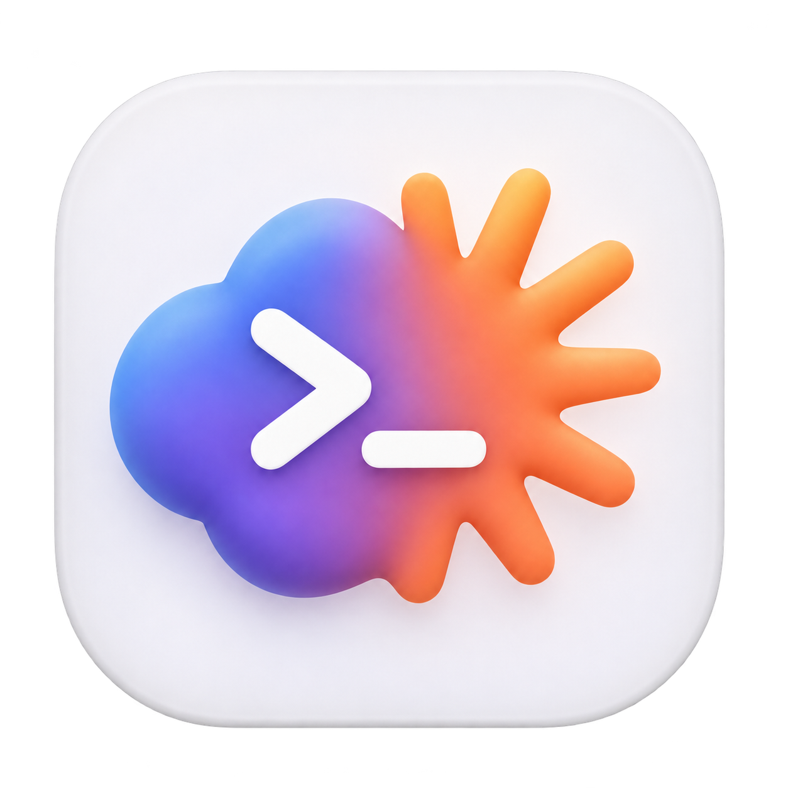
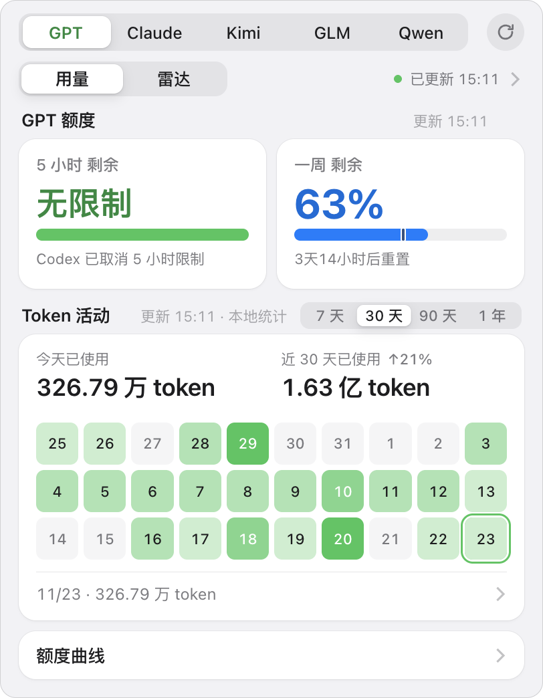
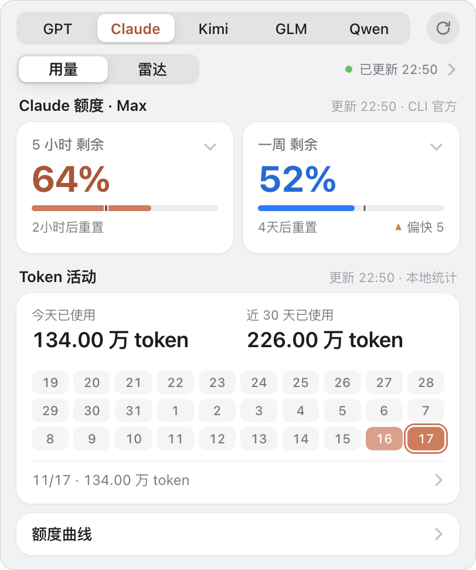

# Codex Menu Meter 1.0.0

> **本 APP 主要由 Claude Fable5.2 和 GPT6-Astra 生成。**

开发者：**Jerry Wong** · 首次公开发布：**2026-11-17**

**Codex Menu Meter 是一款 macOS 菜单栏用量工具，让你随时查看 Codex 和 Claude Code 还剩多少额度、何时重置，以及最近用了多少 Token。** 它把额度面板、消耗趋势、模型雷达和提醒放在一起，并支持 Touch Bar、手机查看和可选的端到端加密云同步。

## 支持哪些平台

| 平台 | 1.0.0 可以查看的内容 | 使用前准备 |
| --- | --- | --- |
| GPT / Codex | 官方剩余额度与重置时间、本地 Token 活动、模型雷达 | 在本机完成 Codex 登录 |
| Claude Code | 官方 5 小时 / 周额度、接口提供的模型专项周限额、本地 Token 活动、模型雷达 | 在本机登录 Claude Code CLI，并在设置中开启 Claude |
| Kimi Code | Coding Plan 额度 | 在设置中启用，并填写 Coding Plan 专用 Key |
| GLM Coding Plan | Coding Plan 额度，支持国内站与国际站接口 | 在设置中启用，并填写对应 Key |
| Qwen Coding Plan | 当前版本仅提供说明入口，不读取额度 | 可在设置中按需显示 |

Kimi / GLM 不提供本地 Token 活动和模型 IQ；各平台实际可显示的窗口、专项限额与重置卡，以接口返回为准。

## 主要功能

### 菜单栏与用量面板

- 菜单栏自动刷新当前平台的 5 小时 / 周剩余额度，Claude 使用 `CC` 标识。
- 点击菜单栏即可展开额度卡，查看剩余百分比、进度条和重置倒计时；Claude 的 Fable 等专项周限额也会单独显示。
- 对于接口仅提供周限额的 Codex 账号，5 小时卡显示「无限制」，避免把缺失窗口显示成 0%。
- 展开额度卡可查看同周期的本地 Token 总量、读写量和缓存命中率。
- 支持 **⌥⌘U** 呼出 / 收起面板、点击外部收起，以及全屏应用场景下的悬浮面板。
- 可开启「跟随前台应用」：Codex 或 Claude 桌面端进入前台时，菜单栏和 Touch Bar 自动切到对应平台；也可手动切换。此功能不识别 Terminal / iTerm 内的具体标签页。

### Token 活动与成本参考

- 离线统计本机 Codex 和 Claude Code 会话，显示今天及近 **30 天**的 Token 活动与热力图。
- 区分 Token 总量、读写量与缓存读取；点击日期查看当天详情。
- 提供按模型 API 单价折算的成本参考，便于比较使用量。**这不是订阅账单，也不代表实际扣费。**
- 本地统计只覆盖这台 Mac 留存的日志；官方剩余额度反映的是账号状态，两者不是同一种统计口径。

### 额度曲线、使用节奏与提醒

- 在 **近 24 小时 / 近 7 天**之间切换，观察 5 小时、周额度及专项限额的消耗曲线。
- 用匀速参考线比较当前消耗与窗口进度，并估算是否会在重置前耗尽额度。预测基于当前窗口的平均消耗速度，会随使用情况变化。
- 支持低额度提醒（默认剩余 **20% / 5%**）、预计提前用尽提醒和窗口重置提醒。
- 提醒可通过 macOS 系统通知送达，也可选配 **Bark / ntfy** 推送到手机。

### 模型雷达与重置信息

- 雷达页分为 **「智力」「额度」「重置」** 三个页签。
- 智力页展示第三方雷达的模型 IQ、推荐信息及可用的费用、速度和样本指标；Codex 模型支持分组与排序。
- 额度页查看雷达提供的模型消耗与额度参考；重置页查看账号窗口的重置时间，以及接口提供的可用重置卡信息。
- 雷达数据来自 **Codex Radar / Claude Code Radar**，保留来源标注；它不是本应用自行测出的评分。雷达站不可用时，官方额度与重置时间仍可独立显示。

### Touch Bar

- 在配有 Touch Bar 的 Mac 上显示剩余额度、重置时间及可用的模型 IQ。
- 支持切换平台；点击额度块可打开桌面面板并刷新。
- 没有 IQ 数据时，额度区域会利用可用空间，并可显示专项限额。

### 手机查看与加密云同步

- **局域网 / Tailscale：** 在 Mac 设置中开启手机查看，使用配对二维码或链接访问只读面板；Mac 需要保持运行且手机能够连到它。
- **加密云同步：** 将用量快照加密后同步到自建服务。Mac 离线时，手机仍可查看最后一次同步的数据。
- 手机页面可添加到主屏幕，使用与 Mac 一致的新图标。
- **公开版本不附带公共云服务。** 云同步需自行部署项目中的 Cloudflare Worker，再在设置中填写地址和完成配对。原有用户升级会保留已保存的服务地址与配对。

### 外观与日常设置

支持 **中文 / English / 日本語**，以及**浅色 / 深色 / 跟随系统**。可设置开机自启动、显示的平台、提醒阈值、快捷键和前台自动切换。

*截图使用合成测试数据。*

## 下载、安装与首次使用

1. 在下方 **Assets** 下载与你的 Mac 芯片对应的 DMG：
   - **Intel：**`Codex-Menu-Meter-macOS26-Intel-1.0.0.dmg`
   - **Apple Silicon（M 系列）：**`Codex-Menu-Meter-macOS26-AppleSilicon-1.0.0.dmg`
2. 打开 DMG，将 **Codex Menu Meter** 拖入 **Applications**，然后启动。使用安装包不需要额外安装 Node.js。
3. 完成本机 Codex / Claude Code CLI 登录，**右键点击菜单栏用量文字打开设置**，开启需要的平台。
4. 左键查看面板；按需配置手机查看、通知和云同步。覆盖安装会保留本机设置。

安装包采用 **ad-hoc 签名，未经过 Apple Developer ID 公证**。首次打开可能需要在「系统设置 → 隐私与安全性」中选择「仍要打开」。文件名沿用历史 `macOS26` 命名，不代表只支持该版本，也不代表已验证所有 macOS 版本。

Release 同时提供源码 ZIP 和 `SHA256SUMS.txt`。源码运行、构建与自建云同步方法见 [README](https://github.com/WZR0821/Codex-Menu-Meter#readme)。

## 数据与隐私

- 账号额度来自对应服务接口；Token 活动在本机离线统计，**不会用本地 Token 数反推官方剩余额度**。
- Codex / Claude 登录凭据由本机读取；Kimi / GLM Key 由用户自行配置。凭据不会随源码、安装包或云同步快照分发。
- 云同步使用端到端加密，服务端接收鉴权信息和加密快照，无法读取快照明文。原始会话内容不上传到云同步服务。
- 启用 Bark / ntfy 后，提醒标题与正文会发送到你配置的推送服务。
- 官方请求失败时保留上一次成功数据并显示错误或更新时间；不能把旧快照当成刚刷新的额度。

## 首发前修复

- 修复 Codex 重复累计快照造成 Token 重复计数。
- 修复 Claude 空对象或无效百分比误显示「剩余 100%」。
- 修复日志缓存跨日不清理，以及乱序历史条目残留。
- 修复日志文件被替换后混入旧数据；读取失败时不再提前推进缓存解析状态。
- 更新 Codex × Claude 融合图标，统一 Mac 与手机主屏图标，并移除默认私人云同步地址。

## 验证范围

**91 项自动测试、JavaScript 语法检查通过。** 桌面浅色 / 深色、用量与雷达、设置页及手机窄屏完成布局检查；本地加密云同步的首次配对、配对链接清理与重新载入验证通过。两个架构的安装包均通过签名、文件一致性及 DMG 完整性检查，生产依赖审计为 0 个已知漏洞（发布时检查结果）。

当前 Intel Mac 已安装新版；Apple Silicon 包尚未在对应实机启动。真实手机 Safari、Touch Bar 硬件、全屏交互和开机启动未完成全面实机回归。外部用量接口与雷达服务的可用性取决于对应服务。

---

本项目为独立第三方工具，与 OpenAI、Anthropic 无隶属关系。仓库目前没有指定开源许可证。
